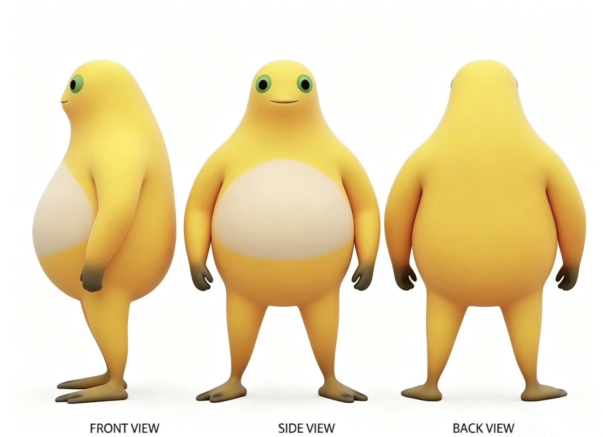

# Nai-waa 角色代入 Skill

根据随包保存的 Nai-waa（Na-waa）三视图和三维效果图，将目标图片中指定的人物替换为该角色，保留原图动作、场景和构图。

GitHub 仓库：[TangHongyu/Nai-Waa](https://github.com/TangHongyu/Nai-Waa)。

这是供 Codex 读取的技能说明与角色参考资源，不是独立运行的应用，也不包含训练后的模型权重。实际图像编辑需要运行环境提供图像生成与编辑工具；仅将本仓库上传到 GitHub 不会自动开启生图能力。

## 角色参考



第一张参考底部的 FRONT VIEW 与 SIDE VIEW 标注有误。实际从左到右依次为侧面、正面、背面。技能按可见结构使用参考，不将这些文字带入成图。


主要辨识特征为暖金黄色圆润身体、奶油米白色腹部、绿色眼部外圈与大黑瞳孔、深色手掌及宽扁分趾脚。具体约束见 [角色资料](references/character-identity.md)。

## 安装到本地 Codex

### 个人使用

1. 从 [GitHub 仓库](https://github.com/TangHongyu/Nai-Waa) 下载并解压完整仓库，或解压本技能 ZIP。
2. 将包含 `SKILL.md` 的整个文件夹命名为 `nai-waa-character-replace`，复制到个人技能目录 `~/.agents/skills/`。
3. Windows 默认路径通常为 `C:\Users\你的用户名\.agents\skills\nai-waa-character-replace\`。如果使用本机用户 84753，对应 `C:\Users\84753\.agents\skills\nai-waa-character-replace\`。
4. 保留 `assets`、`references` 和 `agents` 子目录，确认没有多套一层同名文件夹。最终应能找到 `nai-waa-character-replace/SKILL.md`。
5. Codex 会自动发现技能变化；如果没有出现，重启后再试。

### 仅在一个项目中使用

把整个技能目录放到项目的 `.agents/skills/nai-waa-character-replace/`，然后在该项目内使用 Codex。

发现路径与刷新行为依据 [OpenAI 官方技能文档](https://learn.chatgpt.com/docs/build-skills)。宿主是否提供图像编辑工具，需以实际会话为准。

## 日常使用

安装后上传一张包含待替换人物的目标图片，再输入：

```text
使用 $nai-waa-character-replace，把这张图中的人物整体替换成 Nai-waa，保留原图动作、背景和构图。
```

有多个人物时明确对象，例如：

```text
使用 $nai-waa-character-replace，只替换画面左侧穿红衣的人，其他人物保持原样。保留 Nai-waa 的黄色身体、奶油色腹部和自身比例。
```

需要继承原人物的服装时写清楚：

```text
使用 $nai-waa-character-replace，替换画面中央人物，同时让 Nai-waa 穿上原人物的外套并拿着同一个杯子，保留原图光线和镜头角度。
```

技能默认保留角色本体外观；不会自动把原人物的衣服套到角色上。原人物的姿态会根据角色自身的身体比例调整。

如果技能尚未安装，也可以将本地 `SKILL.md` 文件附到当前会话，要求读取该文件并按其流程执行。其他子目录必须在本地可访问；直接给一份独立的 `SKILL.md` 文本不能替代参考图片。宿主无法读取本地目录时，同时上传两张角色参考和目标图。

参考图已随技能保存，正常使用无需每次重复上传。图像生成可能发生细节漂移；可以继续要求修正，例如“保留这一版构图，把眼睛外圈改回参考中的绿色，不要拉长双腿”。

## 上传到 GitHub

将本目录内容作为独立仓库的根目录，上传所有文件及子目录。保留 `SKILL.md`、角色资料与两张参考图，便于下载后直接安装。只上传 ZIP 会不便于在线查看和后续修改。

GitHub 是此技能的保存、版本管理和分享位置。上传之后仍需下载或克隆到本地，再按照前面的步骤安装使用。仓库地址和公开或私有属性由仓库拥有者指定。

## 目录

```text
nai-waa-character-replace/
├── README.md
├── SKILL.md
├── agents/
│   └── openai.yaml
├── assets/character-reference/
│   ├── nai-waa-three-views.png
│   └── nai-waa-3d-reference.png
└── references/
    └── character-identity.md
```

## 当前验证状态

已检查目录结构、元数据和参考图片的完整性。两张图与用户提供的原文件一致。尚未提供目标图，因此尚未验证实际替换效果。

## 授权

本仓库未附加开源许可证，也未授予 Nai-waa 角色图像的额外使用许可。若需要面向公众分发，可由权利人另行指定技能文本与角色素材各自的许可条款。
